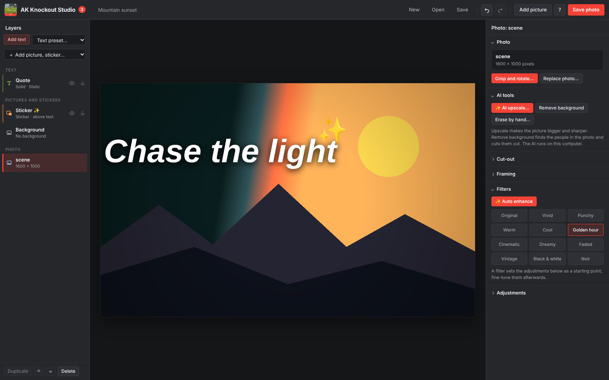

<p align="center">
  
</p>

<h1 align="center">AK Knockout Studio</h1>

<p align="center">
  A free video and photo editor for Windows, Android and the browser: AI upscaling, AI background removal, collages, stickers, multi-clip editing, transitions, music and 4K export — plus <strong>knockout text</strong> where your video plays inside the letters.
</p>

<p align="center">
  <a href="https://github.com/AK30072002/ak-knockout-studio/releases/latest"></a>
  
  
  
  <a href="LICENSE"></a>
</p>

<p align="center">
  <a href="https://github.com/AK30072002/ak-knockout-studio/releases/latest"><strong>⬇ Download for Windows or Android</strong></a>
  &nbsp;·&nbsp;
  <a href="https://ak30072002.github.io/ak-knockout-studio/"><strong>▶ Use it online</strong></a>
  &nbsp;·&nbsp;
  <a href="docs/USER-MANUAL.md"><strong>📖 User manual</strong></a>
</p>



## Download

Open the [latest release](https://github.com/AK30072002/ak-knockout-studio/releases/latest) and download one of these files under **Assets**:

| File | What it is |
| --- | --- |
| `AK-Knockout-Studio-Setup-3.0.0.exe` | **Windows installer (recommended).** Adds a desktop shortcut, a Start menu entry and an uninstaller. |
| `AK-Knockout-Studio-3.0.0-portable.exe` | Windows, nothing to install. Runs straight away, for example from a USB stick. Opens a little slower. |
| `AK-Knockout-Studio-3.0.0.apk` | **Android** phones and tablets (Android 7 or newer). |

**Windows:** the app isn't code-signed, so the first time you open it Windows may show **"Windows protected your PC"**. Click **More info**, then **Run anyway**.

**Android:** download the APK on your phone and open it. If asked, allow your browser or file manager to **install unknown apps**, then tap **Install**. Finished videos and photos are saved to *Documents/AK Knockout Studio* and offered in the share sheet, so you can send them to your Gallery, Drive or WhatsApp.

**No install at all:** use the [online version](https://ak30072002.github.io/ak-knockout-studio/) in Chrome or Edge. To run your own copy, download this repository (**Code → Download ZIP**), extract it, and serve the folder with any local web server (for example `python -m http.server`, then open `http://localhost:8000`). Opening `index.html` directly from disk works for editing, but the AI tools need a web server.

Your videos and photos are never uploaded anywhere. Everything, including the AI tools and export, happens on your own computer.

## What it does

AK Knockout Studio 3 is a complete everyday video **and photo** editor, and every feature is free: no watermark, no account, no subscription. When it opens, it asks what you want to make, **Video**, **Photo** or **Collage**, like a phone editor, and every project is kept automatically in **Drafts**.

Its signature effect is **knockout text**: the editor covers your video or photo with a background and cuts text out of it, so the picture shows through the letters only.

Everything runs on your own computer, including the AI. Nothing is uploaded.

📖 **Full guide:** [USER-MANUAL.md](docs/USER-MANUAL.md) explains every feature step by step.

### New in version 3

| Area | What you can do |
| --- | --- |
| Start screen and Drafts | Choose Video, Photo or Collage; every project is saved automatically with a thumbnail, including copies of its videos and music |
| AI upscaling | Make photos 2× or 4× bigger and sharper with ESRGAN (Fast or High detail), or enlarge with AI while saving; hold to compare with the original |
| AI background removal | Cut people out of photos in one click, and out of videos on every frame; put a blur (portrait mode), colour, gradient or picture behind, or keep it transparent |
| Refine brush | Erase or restore any part of a cut-out by hand; also works on objects |
| Photo editor | Filters, adjustments, auto enhance, crop and rotate, text, stickers, pictures on top; save PNG, JPG or WebP up to 8192 pixels |
| Collage | Up to 9 photos in 24 layouts with spacing, rounded corners and border colour |
| Stickers | About 150 emoji in 8 groups plus 8 colourable shapes |
| Video | Crop clips, reverse clips, auto enhance, AI background removal |

### Also included (from version 2)

| Area | What you can do |
| --- | --- |
| Video track | Any number of video, photo and colour clips. Drag to reorder, drag edges to trim, split, duplicate, delete, replace media, freeze frame |
| Speed | 0.1× to 8× per clip |
| Transitions | Cross dissolve, dip to black, flash, push (4 directions), wipe (2 directions), circle reveal, zoom, blur |
| Looks | 12 one-tap looks plus warmth, sharpen, vignette and film grain |
| Motion | Ken Burns slow zoom and pans |
| Overlays | Picture-in-picture video, logos and PNGs with rounded corners, borders, shadows, blend modes, green screen and 19 animations |
| Audio | Music and sound-effect tracks, voiceover recording, extract audio, fades, loop, master volume |
| Export | Frame-by-frame high quality with H.264, HEVC, AV1 or VP9; 480p to 4K; up to 80 Mbps; sound-only WAV |

### Text styles

Each text layer has a fill mode. **Video in text** is the knockout effect described above. **Video around text** does the opposite: the text becomes a solid cut-out and the video fills everything else. **Video outline** shows the video only in the letter outlines, and **Solid** is ordinary coloured text for captions. Every layer can also have an outline, a glow or a drop shadow, and you choose the font (sixteen built in, or upload your own .ttf/.otf/.woff), weight, size, letter spacing, line height, alignment, italics and capitals.

### Background

The background can be a solid colour, a linear or radial gradient, an image (cover, fit, stretch or tile), a blurred and tinted copy of the video itself, or nothing at all. Lowering the background opacity lets a faint copy of the video through, which is a nice way to hint at the footage before the text reveals it.

### Scroll and motion effects

Every text layer has one motion, chosen from the Motion panel or added from a preset.

| Group | Effects |
| --- | --- |
| Scroll | Credits roll up, scroll down, scroll left (ticker), scroll right, diagonal up, diagonal down, endless horizontal marquee, endless vertical loop, ping-pong, perspective crawl into the distance, zoom-through |
| Entrance | Slide in from any side, zoom in, zoom out, bounce, typewriter, letter by letter, wipe |
| Continuous | Pulse, wave, float, spin, shake |

Scrolls can be timed to fit the layer's length exactly or run at a fixed speed in pixels per second. Every effect has easing, fade in and fade out, and effect-specific settings such as gap, amount and frequency.

**Presets** give you a finished starting point in one click: knockout title, credits roll, news ticker, perspective crawl, zoom-through reveal, side scroll, vertical endless loop, diagonal sweep, wavy headline, typewriter caption, video frame, bold caption, elegant quote and neon glow.

### Editing

- **Timeline** with rows for overlays, text layers, the background, the video track and every audio track. Drag bars to move them, drag their edges to change start and end, and snap to the playhead, clip boundaries and other layers (switch this off with the Snap checkbox). Zoom with the slider or Ctrl + mouse wheel. Clips show thumbnails; the round markers between clips add or edit transitions.
- **Per clip:** trim with in and out points, speed, volume up to 200 %, sound fades, framing (fill, fit or stretch, zoom, position, rotation, flips), looks and colour adjustments.
- **Layers**: add, duplicate, split at the playhead, reorder, hide, lock and delete. Drag text and overlays directly on the video, with centre snapping (hold Alt to drag freely) and optional safe-area guides.
- **Canvas**: 16:9, 9:16, 1:1, 4:5, 4:3, 21:9 or the first clip's own shape, at 24, 25, 30, 50 or 60 fps.
- **Undo and redo** (150 steps), automatic Drafts, project files you can save and reopen (with relinking of moved media), and full-resolution PNG snapshots.

### Export

| Method | Best for |
| --- | --- |
| High quality, frame by frame | Final videos. Every frame is rendered exactly, nothing is dropped. H.264, HEVC or AV1 in MP4, or VP9 / AV1 in WebM, depending on what your computer can encode |
| Real-time recording | Browsers without WebCodecs. Plays the video once while recording |
| Sound only (WAV) | The finished soundtrack, uncompressed |

Resolutions go from 480p to 4K (anything above the project size is upscaled, with optional sharpness enhancement), at 24 to 60 fps and up to 80 Mbps. You can save straight to a file of your choice, which is best for long or 4K videos.

## Building it yourself

- **Windows .exe:** `npm install`, then `npm run dist`. The installer and portable .exe appear in `dist/`.
- **Android APK:** install Android Studio, then `npm install`, `npm run android:sync` and open the `android/` folder in Android Studio (or run `./gradlew assembleDebug` inside it).
- **Online version:** any static web server pointed at this folder.

**Publishing a new version:** change `"version"` in `package.json`, commit, and push a tag with the same number, for example `git tag v3.0.1 && git push origin v3.0.1`. The **Build and release** workflow then builds the Windows .exe files and the Android APK on GitHub's servers and publishes them as a release. Release notes are taken from `docs/release-notes/<tag>.md` when that file exists.

## How to use it

1. **Open the app.** The start screen asks what to make: **Video**, **Photo** or **Collage**. Choose your files, or reopen something from **Drafts**.
2. **Photos:** use **✨ Auto enhance**, **✨ AI upscale…**, **Remove background**, **Crop and rotate…**, filters, text and stickers, then **Save photo**.
3. **Videos:** arrange clips on the timeline (drag to reorder, drag edges to trim, click the round marker between clips for a transition), add text, overlays and music, then **Export video**.
4. **Collages:** pick a layout, spacing and corners, click a photo to edit it on its own, then **Save photo**.

The [user manual](docs/USER-MANUAL.md) walks through every feature with step-by-step recipes.

## Keyboard shortcuts

| Key | Action |
| --- | --- |
| Space | Play / pause |
| ← / → | Step one frame |
| Shift + ← / → | Jump one second |
| Home / End | Go to start / end |
| I / O | Set trim in / out at the playhead |
| T | Add a text layer |
| S | Split the selected clip, layer or audio track at the playhead |
| Ctrl + D | Duplicate the selected item |
| Delete | Delete the selected item |
| Ctrl + I | Import videos, photos or music |
| C | Crop and rotate the selected clip or photo |
| R | Start or stop recording a voiceover |
| Ctrl + Z / Ctrl + Shift + Z (or Ctrl + Y) | Undo / redo |
| Ctrl + S / Ctrl + O | Save / open a project |
| Ctrl + E | Export video |
| L | Loop playback on or off |
| G | Safe-area guides on or off |
| M | Mute |
| F | Full screen |
| ? | Show all shortcuts |
| Esc | Deselect |

On a Mac, use Cmd instead of Ctrl.

## Good to know

- **The AI tools run on your computer.** They are fastest with a graphics card; without one they use the processor and take longer. The first use of each tool loads its model.
- **AI background removal recognises people.** For objects, use the Erase by hand brush or a green screen.
- **AI upscaling is for photos.** Videos are upscaled with high-quality resizing and sharpening, because AI on every video frame would be far too slow on a normal computer.
- **High-quality export renders every frame exactly**, so it can take longer than the video itself, especially at 4K or with AI background removal.
- **Drafts keep copies of your videos and music** in the app's own storage so they reopen complete. Delete drafts you no longer need to free the space. Project files (`.akks.json`) don't contain videos or music; use **Find the files…** after opening one.
- **Fonts load from Google Fonts**, so the built-in fonts need an internet connection.
- **Best in** the Windows app or a current Chrome or Edge. The Android app is great for quick edits; phones are slower for AI and 4K export.

## Project structure

```
index.html            App shell: panels, dialogs, script order
css/style.css         All styling
js/state.js           Project data (modes, clips, overlays, audio, text), events, undo
js/media.js           Media library, relinking, audio routing, clip timing, sound mixing
js/drafts.js          Automatic drafts in IndexedDB, with copies of pictures and media
js/ai.js              On-device AI: ESRGAN upscaling and person segmentation
js/tools.js           Crop, AI upscale, background removal, refine brush, auto enhance, stickers
js/home.js            Start screen (Video, Photo, Collage) and the Drafts list
js/animations.js      Every scroll, entrance and continuous effect, with easing
js/renderer.js        Draws each frame: clips, crop, cut-outs, collage, transitions, looks, overlays, text
js/player.js          Playback clock that keeps every video and audio element in sync
js/timeline.js        Ruler, tracks, dragging, trimming, reordering, thumbnails
js/inspector.js       The properties panel on the right, looks
js/exporter.js        High-quality WebCodecs export, real-time export, WAV, photo saving
js/vendor/            mp4-muxer and webm-muxer (MIT) for writing video files
js/vendor/ai/         TensorFlow.js, UpscalerJS, ESRGAN models, MediaPipe Selfie Segmentation
docs/USER-MANUAL.md   The complete user guide
js/app.js             Wires it together: presets, layers, stage, shortcuts, files
js/native-android.js  Android only: saving and sharing files, Back button
electron/main.js      Desktop (Windows .exe) wrapper, serving the app from app://
android/              Android project (Capacitor); scripts/build-web.mjs prepares www/ for it
capacitor.config.json Android app settings
resources/            Android icon and splash sources
package.json          Build settings for Windows and Android
assets/               Logo and favicon
.github/workflows/    GitHub Pages deployment, and the release build (Windows + Android)
```

The editor itself is plain JavaScript with no build step; third-party code lives only in `js/vendor`. Each file adds its part to a shared `window.KS` object, and `index.html` loads them in order. To add a new motion effect, add an entry to `ANIM_GROUPS` and a matching `case` in `computeAnim` in `js/animations.js`.

## Credits

Made by **AJAIKRISHNA**. The logo is the Network Analyzer icon from [AK30072002/Network-Analyzer](https://github.com/AK30072002/Network-Analyzer).

Video files are written with [mp4-muxer](https://github.com/Vanilagy/mp4-muxer) and [webm-muxer](https://github.com/Vanilagy/webm-muxer) by Vanilagy (MIT). The AI tools use [TensorFlow.js](https://github.com/tensorflow/tfjs) (Apache 2.0), [UpscalerJS](https://github.com/thekevinscott/UpscalerJS) and its ESRGAN models (MIT), and [MediaPipe Selfie Segmentation](https://github.com/google/mediapipe) (Apache 2.0). Their licences are in `js/vendor`. The Android app is built with [Capacitor](https://capacitorjs.com) (MIT).

Released under the [MIT License](LICENSE).
