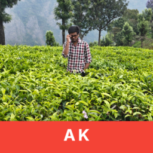
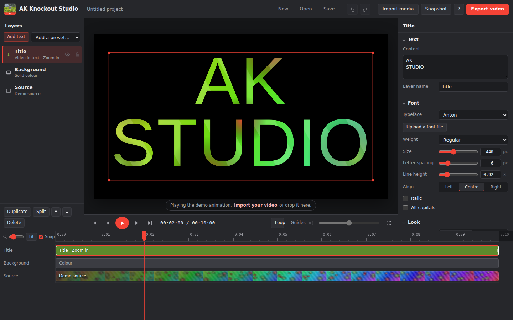

  

<h1 align="center">AK Knockout Studio 2</h1>

  A free video editor for Windows: multi-clip editing, transitions, looks, overlays, green screen, music, voiceover and 4K export — plus <strong>knockout text</strong> where your video plays inside the letters.

  
  
  

  <a href="https://github.com/AK30072002/ak-knockout-studio/releases/latest"><strong>⬇ Download for Windows</strong></a>
  &nbsp;·&nbsp;
  <a href="USER-MANUAL.md"><strong>📖 User manual</strong></a>

## Download and install

1. Open the [latest release](https://github.com/AK30072002/ak-knockout-studio/releases/latest).
2. Under **Assets**, download one of these files:

   | File | What it is |
   | --- | --- |
   | `AK-Knockout-Studio-Setup-2.0.0.exe` | **Installer (recommended).** Adds a desktop shortcut, a Start menu entry and an uninstaller. |
   | `AK-Knockout-Studio-2.0.0-portable.exe` | Runs straight away with nothing installed, for example from a USB stick. Opens a little slower. |

3. Double-click the file you downloaded.
4. If Windows shows **"Windows protected your PC"**, click **More info**, then **Run anyway**. This appears because the app isn't signed with a paid certificate; it only happens the first time.

**Upgrading from version 1?** Just install version 2. Your old project files open automatically.

**To uninstall:** open **Settings → Apps → Installed apps**, find **AK Knockout Studio**, and click **Uninstall**.

**Requirements:** Windows 10 or 11 (64-bit). An internet connection is only needed for the built-in fonts.

Every feature is free: no watermark, no account, no subscription. Your videos are never uploaded anywhere; everything, including export, happens on your own computer.

## Features

| Area | What you can do |
| --- | --- |
| **Video track** | Any number of video, photo and colour clips. Drag to reorder, drag edges to trim, split, duplicate, delete, replace media, freeze frame |
| **Speed** | 0.1× to 8× per clip, with one-tap 0.25× / 0.5× / 1× / 2× / 4× |
| **Transitions** | Cross dissolve, dip to black, flash, push in 4 directions, wipe left or right, circle reveal, zoom and blur; apply to every cut in one click |
| **Looks** | 12 one-tap filters: Vivid, Punchy, Warm, Cool, Golden hour, Cinematic, Dreamy, Faded, Vintage, Black & white, Noir |
| **Adjustments** | Brightness, contrast, saturation, warmth, hue, sharpen, vignette, film grain, blur, greyscale, sepia, invert |
| **Motion** | Ken Burns slow zoom in / out and pans for any clip, great for photo slideshows |
| **Framing** | Fill, fit or stretch, zoom, reposition, rotate (with 90° buttons) and flip |
| **Text** | Unlimited layers, 16 fonts or your own, 11 presets and 26 animations: credits roll, news ticker, perspective crawl, typewriter, bounce, wave and more |
| **Knockout text** | Video inside the letters, video around the letters, or video in the letter outlines |
| **Background** | Colour, gradient, image, blurred video or none |
| **Overlays** | Picture-in-picture video, logos, stickers and PNGs with rounded corners, border, shadow, blend modes and 19 animations |
| **Green screen** | Remove a green, blue, white or black background from any overlay |
| **Audio** | Music and sound-effect tracks: volume up to 200 %, fade in and out, cut, loop, "end with the video"; master volume |
| **Voiceover** | Record your voice straight onto the timeline |
| **Extract audio** | Put a clip's sound on its own track to move or cut it separately |
| **Canvas** | 16:9, 9:16 (Reels, Shorts, TikTok), 1:1, 4:5, 4:3, 21:9 or your clip's own shape, at 24 to 60 fps |
| **Export** | Frame-by-frame high quality in MP4 (H.264, HEVC, AV1) or WebM (VP9, AV1); 480p up to 4K with sharpness enhancement for upscaling; up to 80 Mbps; sound-only WAV; PNG snapshots |
| **Projects** | Undo and redo (150 steps), automatic saving, project files, and reconnecting moved media |

The **[user manual](USER-MANUAL.md)** explains every feature step by step, with recipes for slideshows, vertical Reels, credits, logo watermarks, green screen and voiceovers.

## Quick start

1. Click **Import media** and choose your videos, photos and music (you can select several at once).
2. Click the round **+** marker between two clips on the timeline to add a transition.
3. Click **Title** in the Layers panel and type your own words.
4. Want a normal video without the knockout effect? Click **Background** and choose **None**.
5. Click **Export video**, keep the recommended settings, and click **Start export**.

## Keyboard shortcuts

| Key | Action |
| --- | --- |
| Space | Play / pause |
| ← / → | Step one frame |
| Shift + ← / → | Jump one second |
| Home / End | Go to start / end |
| I / O | Set the clip's in / out point at the playhead |
| S | Split the selected clip, layer or audio track at the playhead |
| T | Add a text layer |
| R | Start / stop recording a voiceover |
| Ctrl + D | Duplicate the selected item |
| Delete | Delete the selected item |
| Ctrl + I | Import videos, photos or music |
| Ctrl + Z / Ctrl + Y | Undo / redo |
| Ctrl + S / Ctrl + O | Save / open a project |
| Ctrl + E | Export video |
| L / G / M / F | Loop, guides, mute, full screen |
| ? | Show all shortcuts |
| Esc | Deselect |

## Good to know

- **High-quality export renders every frame exactly**, so it can take longer than the video itself, especially at 4K. A real-time export mode is also available.
- **Upscaling to 2K or 4K** keeps text and graphics perfectly sharp and enlarges footage with high-quality smoothing and optional sharpening. It isn't AI, so it can't add detail the original doesn't have.
- **Project files don't contain your videos or music.** Keep them in the same folder as the project. If they move, click **Find the files…** after opening the project and everything reconnects.
- **Supported files:** MP4 (H.264) and WebM videos work best; MP3, WAV, M4A, OGG and FLAC for audio; JPG, PNG and WebP for pictures.
- **Found a problem or have an idea?** Open an [issue](https://github.com/AK30072002/ak-knockout-studio/issues).

## Credits

Made by **AJAIKRISHNA**. © 2026 AJAIKRISHNA. All rights reserved.

Video files are written with [mp4-muxer](https://github.com/Vanilagy/mp4-muxer) and [webm-muxer](https://github.com/Vanilagy/webm-muxer) by Vanilagy, used under the MIT licence.
